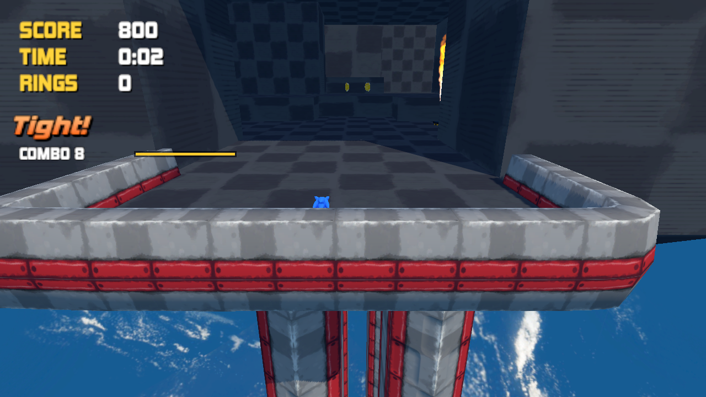
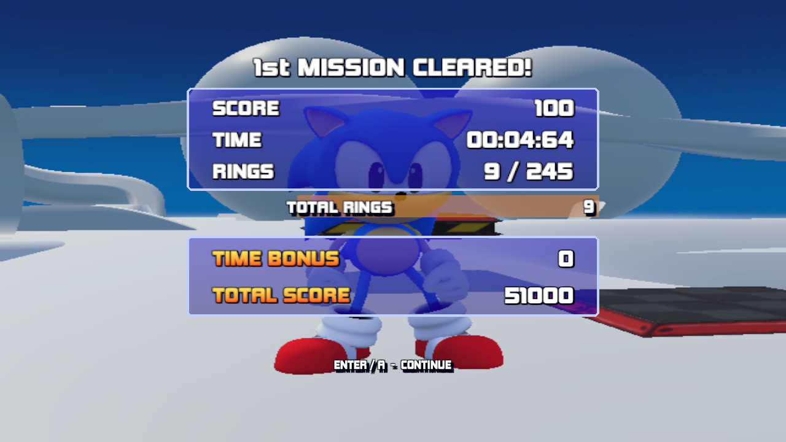

# Hedge Physics Plus

A configurable Unity 6.3 framework for Sonic-style fangames, based on **HedgePhysics** by LakeFeperd and Damizean.

This fork includes the Unity project, playable demonstration scenes, gameplay scripts and the assets needed to open the project. It uses Universal Render Pipeline and Unity's Input System.

## Open the project

1. Install **Unity 6000.3.26f1** through Unity Hub, including Windows Build Support if you want to build the Windows demo.
2. Clone this repository, or download and extract its source ZIP.
3. In Unity Hub, choose **Add project from disk** and select this repository's root: the folder containing `Assets`, `Packages` and `ProjectSettings`.
4. Allow Unity to import the assets and restore the packages.
5. Open `Assets/LogoScreen.unity` and press Play. For a direct gameplay start, open `Assets/[Stage00_Test].unity` or `Assets/[Stage01_AltitudeLimit].unity`.

Blender and Git LFS are not required to open this version. Imported FBX models, native mesh assets and full textures are included. Unity will generate `Library` locally on the first import.

## Features

- Ground and air movement, slopes, rolling, jumping, Spin Dash and Homing Attack.
- Chargeable Drop Dash with configurable charge rate, minimum charge and maximum power.
- Timed combos: each unique enemy defeat refreshes a configurable five-second window, on the ground or in the air.
- Score, stage time, checkpoint time restoration and end-of-stage time/ring bonuses.
- Rings and enemies restored after player death.
- Pause and options menus, keyboard and gamepad input.
- Repaired Sonic and world-object meshes, animations and level colliders for Unity 6.3.
- Private serialized tuning fields, public C# properties and game-wide ability switches.

Extra boosted attacks and rebounds after Drop Dash are **disabled by default**. The normal ground-launching Drop Dash, Homing Attack and free air dash remain available.

## Controls

| Action | Keyboard / mouse | Gamepad |
|---|---|---|
| Move | WASD / arrow keys | Left stick |
| Camera | Mouse | Right stick |
| Jump / Homing Attack / air dash | Space | South button: A / Cross |
| Spin Dash | Hold left Ctrl on the ground | Hold B / Circle |
| Drop Dash | Hold left Ctrl in the air until landing | Hold B / Circle in the air until landing |
| Roll | Left Shift | Right bumper |
| Pause | Escape | Start |
| Confirm in menus | Enter / Space | A / Cross |

Input bindings are in `Assets/Resources/HedgeControls.inputactions`. Menu bindings use `HedgeUI.inputactions`.

## Where the code is

| Path | Purpose |
|---|---|
| [`Assets/GameplayScripts`](Assets/GameplayScripts) | Gameplay code |
| [`PlayerBhysics.cs`](Assets/GameplayScripts/PlayerBhysics.cs) | Movement, gravity, slopes and ground detection |
| [`ActionManager.cs`](Assets/GameplayScripts/ActionManager.cs) | Character actions and input entry points |
| [`PlayerAbilityFeatures.cs`](Assets/GameplayScripts/PlayerAbilityFeatures.cs) | Enable or disable abilities in C# |
| [`Action06_DropDash.cs`](Assets/GameplayScripts/Action06_DropDash.cs) | Drop Dash charge and ground launch |
| [`TechniqueChain.cs`](Assets/GameplayScripts/TechniqueChain.cs) | Timed combos and combo bonuses |
| [`LevelRunState.cs`](Assets/GameplayScripts/LevelRunState.cs) | Score, timer and death/reset state |
| [`Assets/Editor`](Assets/Editor) | Editor tools and regression entry points |

See [the customization guide](ABILITY_CUSTOMIZATION.md) for Inspector settings and C# examples. The guide is currently in Russian.

## Build and checks

The six demonstration scenes are already registered in the project build configuration. Use Unity's **Build Profiles** window to build for Windows.

The editor batch entry point `Unity63Migration.Build` writes a Windows development build to `Builds/Windows/HedgePhysics.exe`. Generated builds are excluded from source control.

Useful batch entry points:

- `MigrationValidation.Audit` — scene, mesh, collider and shader checks.
- `MigrationValidation.Smoke` — basic gameplay, input, loading and visual checks.
- `AdventureChainTests.Run` and `AdventureChainTests.Altitude` — timed combo checks in both gameplay scenes.
- `ClassicPresentationTests.Run` — HUD, score and result-screen checks.
- `HomingSafetyTests.Stage00` — target lifetime and normal air-dash checks.
- `CustomizationTools.Stage00` — configuration and optional-ability checks; the fixture temporarily enables optional abilities and restores their previous values afterward.

Checks write local reports under `Migration`. Historical import/repair commands are development tools; they are not required to open or play the project. See [porting notes](docs/PORTING.md).

## Credits and license

HedgePhysics was created by **LakeFeperd and Damizean**. The upstream source used for this fork is [dudemancart456/HedgePhysics](https://github.com/dudemancart456/HedgePhysics).

The original **BSD 3-Clause** license is preserved in [LICENSE](LICENSE). See [THIRD_PARTY_NOTICES.md](THIRD_PARTY_NOTICES.md) for bundled demonstration assets. This is an unofficial fan framework and is not affiliated with SEGA or Sonic Team.
